# Tags: #BEJSON #BrowserEditor #MFDB #WebCrypto #DataIntegrity

# Modern BEJSON Editor (104-Only Build)

> Single-file, dependency-free browser editor and visual spreadsheet grid for BEJSON (104/104a) documents and Multi-File Database (MFDB v1.31) manifests and entities.

[]()
[](https://boehnenelton2024.pages.dev/apps/bejson-web-editor/)
[]()
[]()
[](https://polyformproject.org/licenses/noncommercial/1.0.0/)
[]()

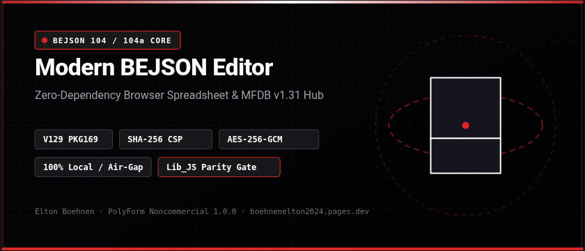

---

## Technical Metadata & Credits

- **Application Name:** BEJSON Editor (104-Only Build)
- **Primary Executable:** `BEJSON_Editor_JS.html`
- **Live Browser App:** [boehnenelton2024.pages.dev/apps/bejson-web-editor/](https://boehnenelton2024.pages.dev/apps/bejson-web-editor/)
- **Target Runtime:** Modern Web Browsers (Chrome, Edge, Firefox, Safari) & Android Termux
- **Current Version:** V129 / PKG169
- **Format Heritage:** BEJSON 104 and 104a (Foundational & Metadata Eras)
- **Database Engine:** MFDB v1.31 Multi-File Database Architecture
- **Cryptographic Standard:** Web Crypto API (AES-256-GCM, PBKDF2-SHA256 100k iterations)
- **Security Policy:** Strict Content Security Policy (SHA-256 Script Hash, Zero `'unsafe-inline'`)
- **Author & Format Creator:** Elton Boehnen
- **Email Contact:** [boehnenelton2024@gmail.com](mailto:boehnenelton2024@gmail.com)
- **Web Portal:** [boehnenelton2024.pages.dev](https://boehnenelton2024.pages.dev)
- **Source Repository:** [github.com/boehnenelton/BEJSON_Editor](https://github.com/boehnenelton/BEJSON_Editor)
- **Relational Document ID:** `3f6c1d52-7a0e-4b8d-9a47-5c2e8b91d0a4`

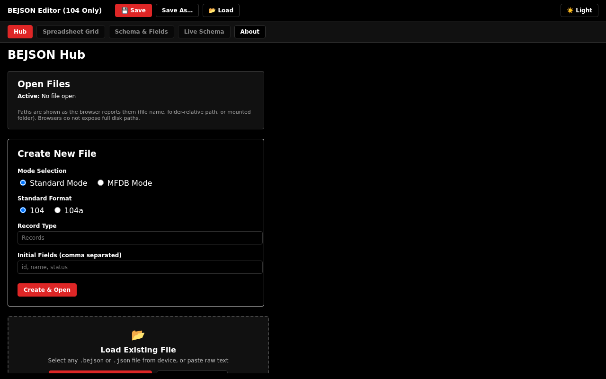

---

## Table of Contents

1. [Executive Overview](#1-executive-overview)
2. [Acronyms & Technical Definitions](#2-acronyms--technical-definitions)
3. [Supported Formats & Architectural Scope](#3-supported-formats--architectural-scope)
4. [Core Architectural Invariants](#4-core-architectural-invariants)
5. [Interface Layout & Navigation Overview](#5-interface-layout--navigation-overview)
6. [Comprehensive Usage Guide](#6-comprehensive-usage-guide)
   - [6.1 Standard Mode Workflows](#61-standard-mode-workflows)
   - [6.2 Grid Editing & Navigation](#62-grid-editing--navigation)
   - [6.3 Selection System & Crosshair Highlights](#63-selection-system--crosshair-highlights)
   - [6.4 Schema & Field Operations](#64-schema--field-operations)
   - [6.5 Strict Data Types & Cell Coercion](#65-strict-data-types--cell-coercion)
   - [6.6 Live Schema & Syntax Highlighting](#66-live-schema--syntax-highlighting)
   - [6.7 Custom Header Management (104a)](#67-custom-header-management-104a)
   - [6.8 Client-Side AES-GCM Cryptography](#68-client-side-aes-gcm-cryptography)
   - [6.9 Multi-File Database (MFDB) Workflows](#69-multi-file-database-mfdb-workflows)
   - [6.10 Local Directory Mounting (File System Access API)](#610-local-directory-mounting-file-system-access-api)
   - [6.11 Validation Reporting & Diagnostic Codes](#611-validation-reporting--diagnostic-codes)
   - [6.12 Save, Save As, and Export Gates](#612-save-save-as-and-export-gates)
7. [System Architecture & Data Flow](#7-system-architecture--data-flow)
8. [Keyboard Shortcuts & Context Menus](#8-keyboard-shortcuts--context-menus)
9. [Error Codes & Diagnostics Directory](#9-error-codes--diagnostics-directory)
10. [CSP Maintenance & Hash Verification](#10-csp-maintenance--hash-verification)
11. [Troubleshooting & Diagnostic FAQ](#11-troubleshooting--diagnostic-faq)
12. [PolyForm Noncommercial License 1.0.0](#12-polyform-noncommercial-license-100)

---

## 1. Executive Overview

The **Modern BEJSON Editor (104-Only Build)** is a high-performance, single-file browser application built in vanilla JavaScript to create, inspect, edit, validate, encrypt, and orchestrate tabular BEJSON datasets and federated MFDB database structures.

Delivered as an entirely self-contained HTML asset (`BEJSON_Editor_JS.html`), the application requires zero external runtime dependencies, no backend web server, and no remote cloud connectivity. All file processing, cryptographic operations, schema verifications, and directory mounts execute locally inside the browser sandbox, ensuring absolute privacy, air-gapped readiness, and instant zero-latency interaction.

The editor incorporates full validator parity with the canonical `Lib_JS` library (`lib_bejson_Core_bejson_validator.js` and `lib_bejson_Core_mfdb_validator.js`). It prevents invalid documents from being saved, exported, or generated through any user interface action, providing an authoritative reference workbench for BEJSON 104 and 104a workflows.

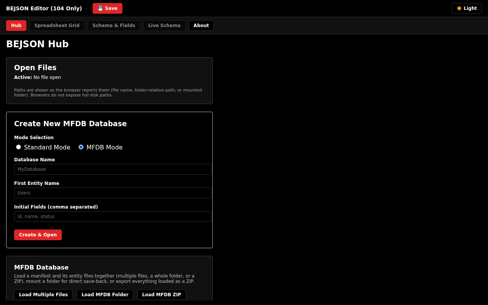

---

## 2. Acronyms & Technical Definitions

To ensure precise semantic clarity across all technical interactions and documentation:

- **BEJSON (Boehnen Elton JSON):** An authoritative, positional data serialization format created by Elton Boehnen. BEJSON separates tabular data into a structured envelope consisting of fixed header metadata (`Format`, `Format_Version`, `Format_Creator`), a declared record classification (`Records_Type`), an ordered column specification array (`Fields`), and a 2D matrix of row values (`Values`). By replacing repetitive key-value dictionary serialization with index-mapped arrays, BEJSON achieves high compression, deterministic parsing speed, and verifiable schema integrity.
- **MFDB (Multi-File Database):** An architectural file-system database specification that organizes relational data across collections of self-describing BEJSON files. A central database manifest (`104a.mfdb.bejson`) tracks individual entity tables (`data/<entity_name>.bejson`), declaring relative paths, primary keys, schemas, and record counts. Entity tables maintain bidirectional linkage back to their parent manifest using relative `Parent_Hierarchy` pointers.
- **FMC (Field Map Cache):** An internal $O(1)$ prototype-less hash map indexing column names to integer array positions. Field Map Caching eliminates hardcoded positional index lookups across data operations.
- **CSP (Content Security Policy):** An HTTP/HTML security mechanism enforcing that only authorized scripts execute. This editor operates under a strict SHA-256 hash whitelist with zero `'unsafe-inline'` script permissions.

---

## 3. Supported Formats & Architectural Scope

This editor build is dedicated exclusively to Foundational and Metadata Era specifications:

| Format Specification | Version Identifier | Status | Supported Features |
| :--- | :--- | :--- | :--- |
| **BEJSON 104** | `"104"` | Supported | Foundational envelope, primitive + structured types (`string`, `integer`, `number`, `boolean`, `array`, `object`), `Parent_Hierarchy` support. |
| **BEJSON 104a** | `"104a"` | Supported | Metadata envelope, primitive-only types (`string`, `integer`, `number`, `boolean`), custom root-level metadata headers. |
| **MFDB Manifest** | `"104a"` + `Records_Type: ["mfdb"]` | Supported | Multi-entity catalog, `Network_Role`, entity paths, record count synchronization, ZIP archive bundle import/export. |
| **MFDB Entity** | `"104"` + `Parent_Hierarchy` | Supported | Isolated relational entity tables linked to root manifests via relative paths. |
| **BEJSON 104db** | `"104db"` | Excluded | Multi-record type polymorphic tables are permanently out of scope for this build. |
| **BEJSON 105 Series** | `"105"`, `"105a"`, `"105db"` | Excluded | Integrity Era UUIDv4-tracked documents are maintained in the parallel 105 editor build. |

---

## 4. Core Architectural Invariants

The application enforces the following invariant rules:

1. **Zero External Requests:** The application makes zero outbound HTTP, WebSocket, or tracking calls (`connect-src 'none'`). All operations are 100% air-gapped and local.
2. **Validator Parity Law:** The editor never marks a document valid if the canonical `Lib_JS` validator rejects it, never rejects a document `Lib_JS` accepts, and prevents any user interface action, cell edit, schema adjustment, save, or export from emitting an invalid document.
3. **Mandatory Field Map Cache:** All table lookups and mutations resolve column coordinates through an $O(1)$ prototype-less field map cache (`Object.create(null)`). Hardcoded column indices are prohibited.
4. **Strict Typing Discipline:** Numeric, boolean, and structured inputs undergo strict literal parsing. Unparseable, truncated, or invalid inputs are rejected and reverted to the cell's previous valid value.
5. **Atomic Save & Export Gates:** Save, Save As, Download JSON, Save All, and Export ZIP operations verify structural BEJSON validity and MFDB relational integrity before writing to disk.

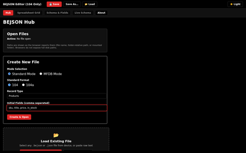

---

## 5. Interface Layout & Navigation Overview

The user interface is organized into two primary regions: the global header navigation bar and the main tab viewing surface.

### Header Toolbar

The top bar provides global file and mode controls:
- **Title & Badge:** Displays the application identity: `BEJSON Editor (104 Only)`.
- **💾 Save (Ctrl+S / Cmd+S):** Immediately commits changes to a mounted disk handle or triggers a browser download.
- **Save As…:** Prompts for a new target filename and saves the active document.
- **📂 Load:** Triggers a native system file picker for `.bejson` and `.json` documents.
- **Table Selector Dropdown:** Active when multiple files or MFDB manifests/entities are loaded, allowing instant context switching.
- **Grid Search Box:** Real-time text filter narrowing displayed table records.
- **MFDB Context Controls:** Buttons for `Load Files`, `Load Folder`, `Load ZIP`, `Mount Folder`, `Validate MFDB`, `Save All`, `Export ZIP`, and `Close All` (dynamically rendered when MFDB mode is active).
- **☀️ Light / 🌙 Dark Toggle:** Shifts interface styling between high-contrast dark (#000000) and clean light (#FFFFFF) themes.

### Navigation Tabs

1. **Hub Tab (`tab-hub`):** Initial landing portal for creating new files/databases, loading existing files, monitoring open file paths, and mounting directories.
2. **Spreadsheet Grid Tab (`tab-grid`):** Main tabular editing surface featuring cell inputs, column selection toggles, record checkboxes, and context menus.
3. **Schema & Fields Tab (`tab-schema`):** Column definitions manager for renaming fields, modifying data types, and deleting columns.
4. **Live Schema Tab (`tab-raw-schema`):** Real-time colorized JSON viewer with formatted syntax highlighting and raw export toggles.
5. **About Tab (`tab-about`):** Technical specification details, version counters (`VERSION` 129, `PACKAGE_VERSION` 169), and format author credit.

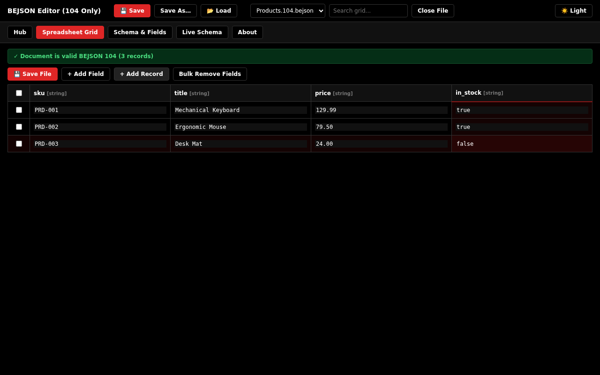

---

## 6. Comprehensive Usage Guide

### 6.1 Standard Mode Workflows

Standard Mode manages standalone BEJSON 104 and 104a data documents.

#### Creating a New File
1. Navigate to the **Hub** tab.
2. Under **Mode Selection**, select **Standard Mode**.
3. Under **Standard Format**, choose **104** (supports primitive, array, and object types) or **104a** (primitive types only).
4. Enter a **Record Type** (e.g., `Users`, `Inventory`, `Telemetry`). Defaults to `NewRecord`.
5. Enter a comma-separated list of **Initial Fields** (e.g., `id, username, email, is_active`).
6. Click **Create & Open**. The document initializes with an empty record matrix and opens in the **Spreadsheet Grid**.

#### Loading Existing Files
- **Header Load Button:** Click **📂 Load** in the header toolbar to select any `.bejson` or `.json` file from your device.
- **Drop Zone Import:** Click **Load Existing JSON / BEJSON** inside the Hub dropzone.
- **Drag-and-Drop:** Drag any `.bejson` file from your operating system file manager and drop it anywhere over the editor window.
- **Paste Raw Text:** Click **Paste BEJSON Text**, paste formatted JSON/BEJSON into the modal dialog, and click **Load BEJSON**.

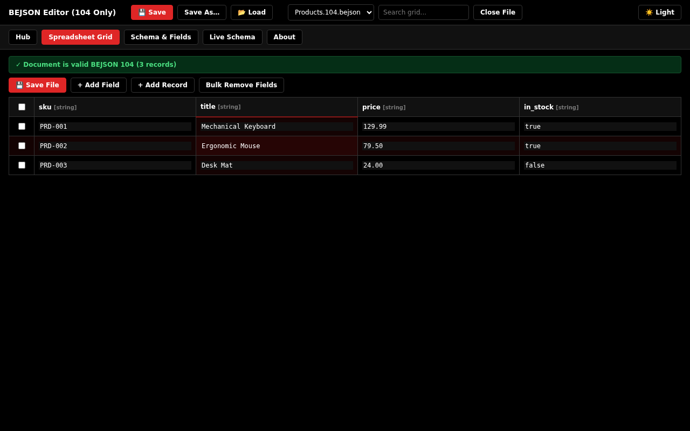

---

### 6.2 Grid Editing & Navigation

The **Spreadsheet Grid** renders records in an interactive, responsive data table.

- **Cell Data Entry:** Click any cell input and type directly. The input field features transparent zero-outline styling, while the containing cell `<td>` highlights with a soft, semi-transparent red background (`rgba(222, 38, 38, 0.08)` in light mode, `0.14` in dark mode).
- **Adding Records:** Click **+ Add Record** on the grid toolbar. A new row appends with default values conforming to declared column types (strings get `""`, numbers/integers get `0`, booleans get `false`, arrays/objects get `null`).
- **Navigating Rows:** Use standard keyboard navigation (`Tab` moves right, `Shift + Tab` moves left, `Up` / `Down` arrows move vertically).
- **Instant Search:** Type any string into the **Search grid...** box in the header toolbar. The table filters immediately to rows containing matching text across unencrypted cells. A status banner alerts if rows exceed the 2,000-row render limit.

---

### 6.3 Selection System & Crosshair Highlights

The editor employs a subtle visual selection system:

- **Active Cell Crosshairs:** Clicking or focusing any table cell instantly tints its entire row (`tr.row-active-highlight`) and column (`td.col-active-highlight`) with a gentle crosshair tint (`0.05` light / `0.09` dark), providing rapid spatial orientation across wide tables without obscuring text.
- **Field Header Selection (Checkbox Toggle):** Clicking any column header toggles multi-column selection. Selected headers display a prominent inline red checkmark (`<span style="color: #DE2626;">✓</span>`), a subtle header background tint, and a 2px red bottom accent bar.
- **Multi-Column Selection Actions:** When one or more columns are selected, the `#colSelectedControls` bar appears in the grid toolbar:
  - **🧹 Clear Col:** Clears all cells in selected columns to `null` across all records.
  - **🗑 Delete Col:** Permanently deletes selected columns from the schema and all records.
  - **✕ Deselect:** Clears active column selections.
- **Record Checkbox Selection:** Click the checkbox at the start of any row to select records. Checked rows display `.row-selected` styling with a 3px red left border accent. Use the header checkbox to select or deselect all records simultaneously.
- **Off-Cell Deselection:** Clicking anywhere outside table cells (whitespace, headers, toolbar, background) immediately dismisses active cell selection and blurs focused inputs. Pressing `Escape` while in the grid also unselects the active cell.

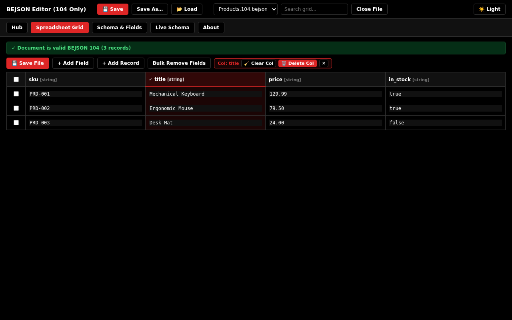

---

### 6.4 Schema & Field Operations

The schema system enforces strict naming rules and type consistency.

#### Adding New Fields
1. Click **+ Add Field** on the grid toolbar or Schema tab.
2. In the **Add New Field(s)** dialog, type one or more comma-separated field names.
3. Select the target **Field Type** from the dropdown menu. In BEJSON 104a, the dropdown restricts options strictly to primitive types (`string`, `integer`, `number`, `boolean`).
4. Click **Add Field**. The editor validates names using `checkNewFieldNames()`:
   - Forbids reserved JavaScript properties (`__proto__`, `constructor`, `prototype`).
   - Forbids core BEJSON envelope keys (`Format`, `Format_Version`, `Format_Creator`, `Records_Type`, `Fields`, `Values`, `Parent_Hierarchy`).
   - Forbids empty names and duplicate names within the existing schema.
5. All existing records are automatically padded with valid default values for the newly appended columns.

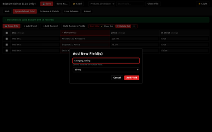

#### Editing Existing Fields
1. Right-click or long-press any column header, or open the **Schema & Fields** tab.
2. Select **✏ Edit Field**.
3. Modify the field name or change the field type.
4. When changing a field's data type, `applyFieldChange()` invokes `coerceCellForType()`:
   - Numbers converting to integers are safely truncated (`Math.trunc`).
   - Strings converting to numeric/boolean types are strictly parsed; invalid values become `null`.
   - Structured types converting to incompatible primitives become `null` (preventing validation errors).
   - Columns containing encrypted ciphertext (`ENC:AES-GCM:...`) cannot be changed to non-string types until decrypted.
5. Click **Save Changes**. If any validation error is detected, the dialog remains open with a clear explanation.

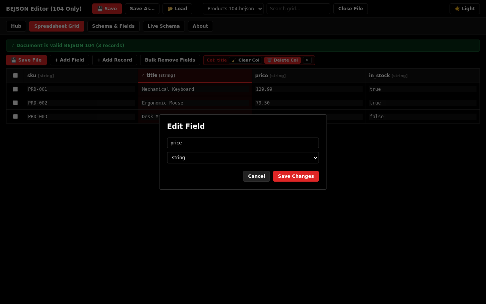

#### Deleting Fields & Columns
- **Single Column Delete:** Select **🗑 Delete Field (Column)** from a field header menu or click **Delete** on the Schema tab. A confirmation prompt confirms that the entire column will be removed from all records.
- **Bulk Field Removal:** Click **Bulk Remove Fields** on the grid toolbar to open `#modalBulkDeleteFields`. Check desired columns and click **Delete Selected Fields**.
- **Last Field Protection:** Deleting the last remaining field is strictly prohibited (`Fields` must be a non-empty array).
- **Manifest Required Field Protection:** In MFDB manifests, deleting `entity_name` or `file_path` is blocked.

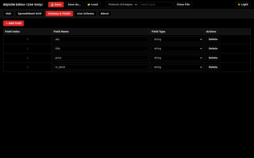

---

### 6.5 Strict Data Types & Cell Coercion

The editor enforces strict type verification upon editing cells:

| Declared Type | Valid Values | Input Parsing Rules | Invalid Input Action |
| :--- | :--- | :--- | :--- |
| `string` | UTF-8 text, ciphertext | Accepted verbatim. Empty string stored as `""`. | None. All text is valid. |
| `integer` | Signed integers | Strict integer regex (`^[+-]?\d+([eE][+-]?\d+)?$`). Truncated strings like `"12abc"` or decimals like `"3.5"` rejected. | Alert displayed; input reverted. |
| `number` | Floating-point | Strict finite number regex (`^[+-]?(\d+\.?\d*\|\.\d+)([eE][+-]?\d+)?$`). Trailing text or `Infinity`/`NaN` rejected. | Alert displayed; input reverted. |
| `boolean` | `true`, `false` | Accepts case-insensitive `"true"`, `"false"`, `"1"`, `"0"`. | Alert displayed; input reverted. |
| `array` | JSON Array (104 only) | Must parse as valid JSON array (e.g. `[1, "item"]`). Empty input stores `null`. | Alert displayed; input reverted. |
| `object` | JSON Object (104 only) | Must parse as valid JSON object (e.g. `{"id": 10}`). Empty input stores `null`. | Alert displayed; input reverted. |

#### Advanced Cell Editor Modal
For multiline strings, formatted JSON arrays, or complex objects, right-click any cell and select **Advanced Edit Cell** to open `#modalCellEditor`. This provides a spacious textarea with dedicated **Copy**, **Paste**, and **Select All** buttons.

---

### 6.6 Live Schema & Syntax Highlighting

The **Live Schema** tab (`tab-raw-schema`) provides a colorized view of the active document:

- **Syntax Highlighter:** Differentiates JSON keys (bold white/black), strings (#b91c1c red in light / #fca5a5 in dark), numbers (#16a34a green), booleans (#0284c7 blue), and null values (italicized grey).
- **Include Records Toggle:** The checkbox `Include Records (Values)` controls whether rows are included in the view:
  - **Checked (Default):** Shows complete document with up to 500 records in the preview.
  - **Unchecked:** Renders schema-only metadata while preserving `Values: []` as an empty array, maintaining 100% BEJSON compliance.
- **Copy Schema:** Copies the full JSON document to the system clipboard.
- **Download JSON:** Validates and downloads the current view as a `.json` file.

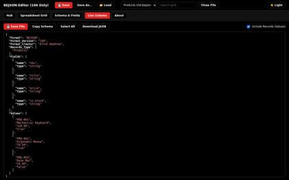

---

### 6.7 Custom Header Management (104a)

BEJSON 104a permits root-level custom metadata headers preceding the tabular envelope.

1. When a 104a document is active, click **Custom Headers** in the grid toolbar.
2. In `#modalEditHeaders`, existing custom headers display with key and value inputs.
3. To add a new header, specify **New Header Key** and **Value**, then click **Add**.
4. **Header Invariants:**
   - Custom headers are permitted in BEJSON 104a only; opening the modal on a 104 file is blocked.
   - Keys beginning with `_` are rejected (reserved for internal runtime caches).
   - Core envelope keys (`Format`, `Format_Version`, `Fields`, `Values`, etc.) cannot be overwritten.
   - Reserved JavaScript properties (`__proto__`, `constructor`, `prototype`) are strictly blocked.
5. **Serialization Order:** Clicking **Save** canonicalizes key order in place:
   ```json
   {
     "Format": "BEJSON",
     "Format_Version": "104a",
     "Format_Creator": "Elton Boehnen",
     "Custom_Header_1": "Metadata Value",
     "Records_Type": ["Example"],
     "Fields": [...],
     "Values": [...]
   }
   ```
   Custom headers sit directly above `Records_Type` and never trail after `Values`.

---

### 6.8 Client-Side AES-GCM Cryptography

Sensitive data can be encrypted directly in the browser using the Web Crypto API.

- **Cryptographic Cipher:** AES-GCM with a 256-bit key derived via PBKDF2-SHA256 (100,000 iterations).
- **Storage Format:** Stored as an inline ciphertext string:
  ```text
  ENC:AES-GCM:<salt_base64>:<iv_base64>:<ciphertext_base64>
  ```
- **Field Type Restriction:** Encrypted strings can only be stored in `string` fields. Non-string fields (`integer`, `boolean`, `array`, `object`) are ineligible for encryption (`cryptoEligible() === false`), as ciphertext strings would cause type-mismatch validation failures.
- **Encrypting a Cell:** Right-click an eligible cell, select **🔒 Encrypt Cell…**, enter an encryption password (minimum 8 characters), and confirm.
- **Encrypting a Record:** Right-click a row index or cell, select **🔒 Encrypt Record…**, enter a password, and confirm. All eligible string cells in the row encrypt atomically.
- **Decrypting Data:** Right-click an encrypted cell or row, select **🔓 Decrypt Cell…** or **🔓 Decrypt Record…**, and enter the original password. If the password is correct, plaintext is restored.
- **Automatic Flag Sync:** If the table contains an `is_encrypted` boolean column, it updates automatically to reflect whether any cell in each row remains encrypted.

---

### 6.9 Multi-File Database (MFDB) Workflows

The MFDB architecture coordinates multiple relational tables under a single database manifest.

#### Creating an MFDB Database
1. Open the **Hub** tab and select **MFDB Mode**.
2. Enter a **Database Name** (e.g., `StoreCatalog`).
3. Enter the **First Entity Name** (e.g., `Products`).
4. Enter initial comma-separated fields for the entity (e.g., `sku, title, price`).
5. Click **Create & Open**. The editor generates two tables:
   - Root manifest: `104a.mfdb.bejson` (Format 104a, `Records_Type: ["mfdb"]`, tracking `Products`).
   - Entity table: `data/products.bejson` (Format 104, `Parent_Hierarchy: "../104a.mfdb.bejson"`).

#### Adding and Removing Entities
- **+ Add Entity:** Click **+ Add Entity** in the grid toolbar or Schema tab. Enter an entity name and initial fields. The editor generates the BEJSON 104 entity document, registers it in the manifest with `schema_version: "1.0.0"`, assigns the first field as `primary_key`, and sets `record_count: 0`.
- **Delete Entity:** Click **Delete Entity**, select the entity from the dropdown menu, and confirm. The entity row is removed from the manifest and its table unloads from memory (disk files remain untouched).

#### Loading MFDB Databases
- **Load Multiple Files:** Click **Load Files** to select the manifest and entity files simultaneously.
- **Load MFDB Folder:** Click **Load Folder** (`webkitdirectory`) to select an entire folder structure containing `104a.mfdb.bejson` and its `data/` subfolder.
- **Load MFDB ZIP:** Click **Load ZIP** to decompress and mount an MFDB ZIP archive directly.
- **Link Resolution:** After loading, `resolveMfdbLinks()` matches loaded entity files against declared manifest rows, updating the table label to display resolution status (e.g., `[Manifest] 104a.mfdb.bejson (3/3 resolved)`).

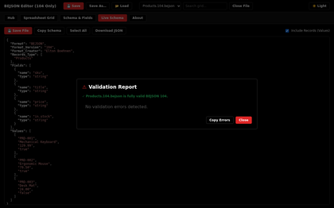

---

### 6.10 Local Directory Mounting (File System Access API)

In Chromium-based browsers (Chrome, Edge, Opera), the editor supports live directory mounting:

1. Click **Mount Folder** on the Hub tab or header toolbar.
2. Select the local directory containing your database.
3. Grant read/write permissions when prompted by the browser.
4. The editor locates `104a.mfdb.bejson` and resolves all declared entity files directly from disk.
5. **Live Save-Back:** Whenever you click **💾 Save** or press `Ctrl + S`, changes write back directly to the local files via `FileSystemFileHandle.createWritable()`, completely bypassing browser download prompts.

---

### 6.11 Validation Reporting & Diagnostic Codes

The editor features a real-time validation engine:

- **Status Banner:** The top banner displays green (`✓ Document is valid BEJSON 104`) or red (`⚠ Validation Alerts (X errors detected)`). Clicking an invalid banner opens `#modalValidationReport`.
- **Inline Error Highlighting:** Invalid cells receive `.cell-invalid` styling (red border, bold text, error tooltip). Rows with length or structural failures receive `.row-invalid` styling. Invalid headers receive `.header-invalid` styling.
- **Copy Validation Report:** Click **Copy Errors** inside the report dialog to copy all diagnostic codes, targets, and explanations to the system clipboard.

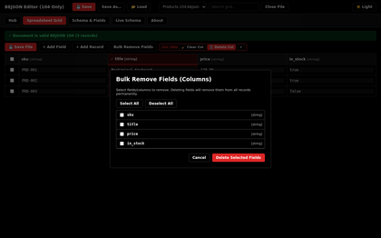

---

### 6.12 Save, Save As, and Export Gates

To preserve repository and database integrity, all export and persistence routines pass through validation gates:

- **Single Document Gate (`canSaveSingleDoc`):** Invoked by **💾 Save**, **Save As…**, and **Download JSON**. If `validateBEJSON()` detects errors, or if the file is an MFDB table that fails MFDB validation, saving is blocked and an error dialog lists the specific violations.
- **MFDB Save All Gate (`saveAllMfdb`):** Verifies every loaded table in memory, checks MFDB relational integrity, resynchronizes manifest `record_count` columns, and writes mounted files. If any table is invalid, the entire operation halts.
- **Export ZIP Gate (`exportLoadedTablesAsZip`):** Performs a pre-export validation pass across all tables, builds a store-method ZIP containing the root manifest and `data/` entities with CRC32 checksums, and downloads `BEJSON_Export-PKG169.zip`.

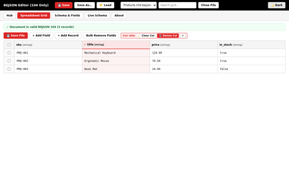

---

## 7. System Architecture & Data Flow

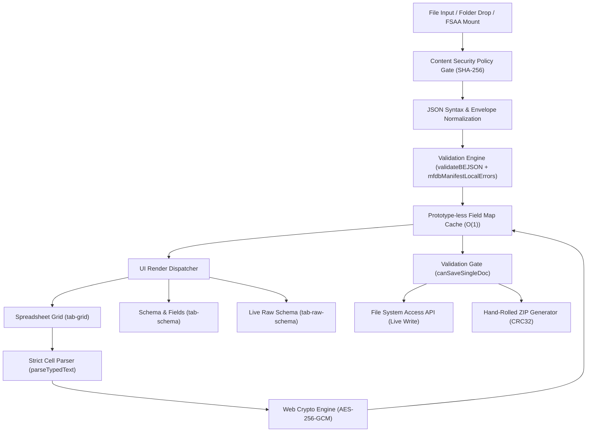

---

## 8. Keyboard Shortcuts & Context Menus

### Keyboard Shortcuts

| Shortcut | Scope | Action |
| :--- | :--- | :--- |
| `Ctrl + S` / `Cmd + S` | Global | Save active table immediately (to mounted disk file or download). |
| `Escape` | Global | Closes top modal dialog; deselects active grid cell if no modal open. |
| `Tab` | Grid Cells | Focuses next table cell input to the right. |
| `Shift + Tab` | Grid Cells | Focuses previous table cell input to the left. |
| `Enter` | Password Modals | Submits cryptographic password dialog. |

### Context Menus (Right-Click / Long-Press)

```
[Field Header Context Menu]
  ├── Column: <name>
  ├── [✓] Select Column / ✕ Deselect Column
  ├── 🧹 Clear Column Cells (sets cells to null)
  ├── ✏ Edit Field (opens Edit Field modal)
  ├── 🗑 Delete Field (Column) (removes column from all rows)
  └── 📋 Bulk Remove Fields… (opens bulk removal checklist)

[Row Index Context Menu]
  ├── Record #<idx> Options
  ├── [✓] Select Record #<idx>
  ├── 🧹 Clear Record Cells (sets row to nulls)
  ├── Advanced Edit Record (opens multiline editor)
  ├── Duplicate Record (deep clone of row)
  ├── 🔒 Encrypt Record… (AES-GCM row encryption)
  ├── 🔓 Decrypt Record… (AES-GCM row decryption)
  └── 🗑 Delete Record (permanently removes row)

[Table Cell Context Menu]
  ├── Cell (<row>, <col>)
  ├── [✓] Select Record (Row #<row>)
  ├── [✓] Select Column (<name>)
  ├── 🧹 Clear Cell Value
  ├── 🧹 Clear Entire Record #<row>
  ├── 🧹 Clear Entire Column "<name>"
  ├── Advanced Edit Cell
  ├── Copy Cell / Paste Cell
  ├── 🔒 Encrypt Cell… / 🔓 Decrypt Cell…
  ├── 🗑 Delete Record #<row>
  └── 🗑 Delete Field (Column) "<name>"
```

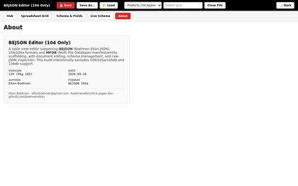

---

## 9. Error Codes & Diagnostics Directory

The editor reports standardized diagnostic error codes:

### Core BEJSON Error Codes (`E01` – `E16`)

| Code | Diagnostic Identifier | Cause & Resolution |
| :--- | :--- | :--- |
| `E01` | `E_INVALID_JSON` | Top-level document is null, primitive, or an array. Root must be a JSON object. |
| `E02` | `E_MISSING_MANDATORY_KEY` | One of 6 required envelope keys (`Format`, `Format_Version`, `Format_Creator`, `Records_Type`, `Fields`, `Values`) is missing. |
| `E03` | `E_INVALID_FORMAT` | Envelope key `Format` is not exactly `"BEJSON"`. |
| `E04` | `E_INVALID_VERSION` | Envelope key `Format_Version` is not `"104"` or `"104a"`. |
| `E05` | `E_INVALID_RECORDS_TYPE` | `Records_Type` is not an array containing exactly one non-empty string. |
| `E06` | `E_INVALID_FIELDS` | `Fields` is empty, contains non-objects, duplicate names, or structured types in 104a. |
| `E07` | `E_INVALID_VALUES` | `Values` is not a 2D array of record matrices. |
| `E08` | `E_TYPE_MISMATCH` | Record cell value does not match declared column type (e.g. string in integer field). |
| `E09` | `E_RECORD_LENGTH_MISMATCH` | Row length does not match column count in `Fields`. |
| `E10` | `E_RESERVED_KEY_COLLISION` | Custom header begins with `_` or is declared on a 104 file. |
| `E16` | `E_INVALID_FORMAT_CREATOR` | Envelope key `Format_Creator` is not `"Elton Boehnen"`. |

### MFDB Relational Error Codes (`E30` – `E41`)

| Code | Diagnostic Identifier | Cause & Resolution |
| :--- | :--- | :--- |
| `E30` | `E_MFDB_NOT_MANIFEST` | Manifest `Network_Role` is not `"Master"`, `"Slave"`, or `"Standalone"`. |
| `E33` | `E_MFDB_PATH_ESCAPES_ROOT` | Manifest `file_path` contains `..` or absolute paths escaping database root. |
| `E35` | `E_MFDB_DUPLICATE_ENTRY` | Manifest declares duplicate `entity_name` or `file_path`. |
| `E40` | `E_MFDB_MISSING_REQUIRED_FIELD` | Manifest `Fields` does not include required `entity_name` or `file_path`. |
| `E41` | `E_MFDB_NULL_REQUIRED` | Manifest row has null or empty `entity_name` or `file_path`. |

---

## 10. CSP Maintenance & Hash Verification

The editor enforces a strict Content Security Policy denying external network traffic and forbidding inline JavaScript execution:

```http
Content-Security-Policy: default-src 'none'; script-src 'sha256-Yb5zqqSfCi48gsaYL9azpSCXa/GRQwUJMvIayWLO60Y='; script-src-attr 'none'; style-src 'unsafe-inline'; img-src data: blob:; font-src data:; connect-src 'none'; frame-src 'none'; object-src 'none'; media-src 'none'; worker-src 'none'; base-uri 'none'; form-action 'none'
```

### Stamping Script Hashes
Whenever JavaScript inside `BEJSON_Editor_JS.html` is edited, its SHA-256 digest changes. The build includes an automated Python maintenance daemon:

```bash
# Verify current CSP hash:
python3 dev/stamp_csp.py --check BEJSON_Editor_JS.html

# Automatically re-stamp hash in meta tag:
python3 dev/stamp_csp.py BEJSON_Editor_JS.html
```

### Build & Environment Verification

| Parameter | Value | Reference Location |
| :--- | :--- | :--- |
| **Project Name** | `BEJSON_Editor_JS` | `bejson_project.json` |
| **Source Executable** | `BEJSON_Editor_JS.html` | `/storage/emulated/0/Admin/Dev/HTML_Apps/Development/BEJSON_Editor_JS/` |
| **Release Version** | `129` | Line 1068 (`const VERSION = "129"`) |
| **Package Counter** | `PKG 169` | Line 1069 (`const PACKAGE_VERSION = "169"`) |
| **Document Fingerprint** | `3f6c1d52-7a0e-4b8d-9a47-5c2e8b91d0a4` | Header metadata & `bejson_project.json` |
| **CSP Script Hash** | `sha256-Yb5zqqSfCi48gsaYL9azpSCXa/GRQwUJMvIayWLO60Y=` | HTML Meta CSP Tag (`line 252`) |
| **Test Conformance** | 38/38 Unit Tests Passed | `dev/run_playwright_tests.py` & harness |
| **Fuzzer Agreement** | 600/600 Test Cases Passed | `Lib_JS` Core Parity Suite |
| **Active License** | PolyForm Noncommercial 1.0.0 | Full text in section 12 |

---

## 11. Troubleshooting & Diagnostic FAQ

<details>
<summary><strong>Q: Why does the editor display "The editor script did not start"?</strong></summary>
The JavaScript inside <code>BEJSON_Editor_JS.html</code> was edited without updating the SHA-256 script hash in the CSP meta tag. Run <code>python3 dev/stamp_csp.py BEJSON_Editor_JS.html</code> to re-stamp the hash.
</details>

<details>
<summary><strong>Q: Why are "Mount Folder" and live disk saves unavailable in Firefox or Safari?</strong></summary>
The File System Access API (<code>showDirectoryPicker</code>) is implemented in Chromium engines (Chrome, Edge, Opera). Non-Chromium browsers use standard file loading and download-based saving.
</details>

<details>
<summary><strong>Q: Why does the editor block saving with an alert?</strong></summary>
The document contains validation errors violating BEJSON 104/104a specifications or MFDB relational constraints. Open the <strong>Validation Report</strong> to view and correct the identified fields.
</details>

<details>
<summary><strong>Q: Can I encrypt an integer or boolean column?</strong></summary>
No. Encrypted values are stored as Base64-encoded ciphertext strings (<code>ENC:AES-GCM:...</code>). Placing a string in a non-string column violates BEJSON type rules. Retype the column to <code>string</code> before encrypting.
</details>

<details>
<summary><strong>Q: How do I export an entire MFDB database for deployment?</strong></summary>
Ensure the manifest and all entity tables are loaded and valid. Click <strong>Export ZIP</strong>. The editor compiles a clean store-method ZIP containing <code>104a.mfdb.bejson</code> and all entity tables under <code>data/</code>.
</details>

---

## 12. PolyForm Noncommercial License 1.0.0

```text
PolyForm Noncommercial License 1.0.0

<https://polyformproject.org/licenses/noncommercial/1.0.0>

## Purpose

This license permits you to use the software only for noncommercial purposes.

## Agreement

In order to receive this license, you have to agree to its rules.
The rules of this license are both terms of the software license
and conditions for using the software.  You are not licensed to
use the software under any other terms or conditions.

## Notices

You must ensure that everyone who gets a copy of any part of this
software from you, with or without changes, also gets the text of
this license or a link to <https://polyformproject.org/licenses/noncommercial/1.0.0>.

## Copyleft

If you make changes to this software and provide copies of the
software, with or without your changes, to someone else, you must
make your changes available under this same license.  You can do
that by publishing the source code to your changes along with the
software, as described in the Notice section of this license, or by
offering to provide the source code to your changes to anyone who
gets a copy of the software from you.

## Noncommercial Purposes

Any purpose is a noncommercial purpose except for purposes intended
for or directed toward commercial advantage or monetary compensation.
Commercial purposes include, but are not limited to, using this
software to provide a service for which you charge a fee, using this
software to develop a commercial product, using this software in
the operation of a business, and reselling this software.

## Fair Use

You may have rights under the law, including fair use, that permit
you to use this software in ways not covered by this license.  This
license does not limit those rights.

## No Other Rights

This license does not grant you any right to use any trademark,
trade name, logo, or service mark of the licensor, or any right to
patent claims of the licensor.

## Disclaimer

As far as the law allows, this software comes as is, without any
warranty or condition, and no licensor will be liable to anyone for
any damages of any kind or on any theory, arising out of the use
of this software, if you agreed to this license or not.
```

---

*BEJSON Editor JS · Version 129 · Package PKG 169 · Maintained by Elton Boehnen · [boehnenelton2024.pages.dev](https://boehnenelton2024.pages.dev)*
